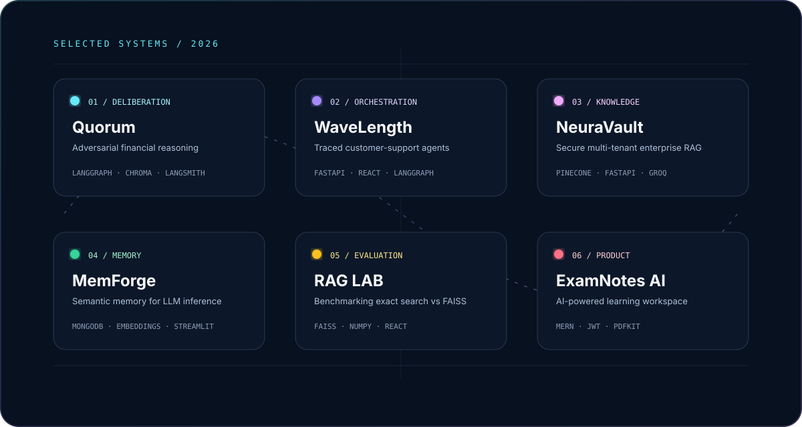

<div align="center"> <picture>
<source media="(prefers-color-scheme: dark)" srcset="assets/hero-dark.svg">
  <source media="(prefers-color-scheme: light)" srcset="assets/hero-light.svg">
  
</picture>   


<a href="mailto:paras160500@gmail.com"></a>
<a href="https://www.linkedin.com/in/paras-patel-595600155"></a>
<a href="https://github.com/paras160500"></a>

</div>


## `01 / system.profile`

```yaml
name: Paras Patel
role: AI/ML Engineer
builds:
  - multi-agent systems
  - retrieval and memory infrastructure
  - secure backend products
currently:
  - making agent handoffs observable
  - measuring retrieval instead of guessing
  - turning prototypes into dependable systems
```

I build AI products where the interesting part is not only the model call. The interesting part is the system around it: routing, state, memory, evaluation, access control, tracing, persistence, and a useful interface.

## `02 / featured.systems`

<div align="center">
<a href="https://github.com/paras160500/Quorum-Adversarial-Multi-Agent-Deliberation-for-Financial-Reasoning"></a>
</div>   
 <table width="100%">
<tr>
<td width="33%" valign="top">

### [Quorum](https://github.com/paras160500/Quorum-Adversarial-Multi-Agent-Deliberation-for-Financial-Reasoning)

Adversarial multi-agent financial reasoning with specialist analysis, bull-versus-bear debate, trade-plan generation, and risk review.

`LangGraph` `Chroma` `Streamlit`

</td>
<td width="33%" valign="top">

### [WaveLength](https://github.com/paras160500/WaveLength-Multi-Agent-Orchestration-with-Tracing)

A traced customer-support workspace with specialist handoffs, human verification, persistent thread state, and preference memory.

`FastAPI` `React` `LangGraph`

</td>
<td width="33%" valign="top">

### [NeuraVault](https://github.com/paras160500/NeuraVault-Multi-Tenant-Enterprise-RAG-Platform-with-Secure-AI-Knowledge-Isolation)

Multi-tenant enterprise RAG with private document ingestion and user-scoped knowledge isolation.

`Pinecone` `FastAPI` `Groq`

</td>
</tr>
<tr>
<td width="33%" valign="top">

### [MemForge](https://github.com/paras160500/MemForge-Semantic-Memory-Orchestration-for-Token-Efficient-LLM-Inference)

Semantic memory that turns conversation statements into durable facts and retrieves only what a later question needs.

`MongoDB` `Embeddings` `Streamlit`

</td>
<td width="33%" valign="top">

### [RAG Performance LAB](https://github.com/paras160500/RAG-Performance-LAB-FastAPI-React-Tailwind)

A reproducible benchmark comparing exact NumPy cosine search with FAISS and reporting latency and speedup.

`FAISS` `NumPy` `React`

</td>
<td width="33%" valign="top">

### [ExamNotes AI](https://github.com/paras160500/MERN-AI-Exam-Helper)

A MERN learning workspace that creates revision notes, exam questions, visuals, and printable PDFs.

`MERN` `JWT` `PDFKit`

</td>
</tr>
</table>   


## `03 / other.builds`

<details>
<summary><b>Retrieval, research, and applied AI</b></summary>
  


| Project | What it explores |
| --- | --- |
| [ShopSmart — HyDE RAG](https://github.com/paras160500/HyDE-RAG-Ecommerce-Platfrom-with-Comparision-to-Standard-RAG) | Side-by-side Standard RAG and HyDE e-commerce search with product-level similarity comparisons. |
| [OmniDoc RAG](https://github.com/paras160500/OmniDoc-RAG-Advanced-Multimodal-Retrieval-Augmented-Generation) | Advanced multimodal retrieval-augmented generation. |
| [Frontier AI Product Researcher](https://github.com/paras160500/Frontier-AI-Product-Researcher-MAS-RAG) | Multi-agent product research with retrieval-augmented generation. |
| [DeepSeek Reasoning RAG](https://github.com/paras160500/DeepSeek_Reasoning_RAG) | Reasoning-focused retrieval-augmented generation. |
| [MCP Web Scrapper](https://github.com/paras160500/MCP-Web-Scrapper-for-code-suggestions) | MCP-based web research for code suggestions. |

</details> <details>
<summary><b>Backend systems and APIs</b></summary>
  


| Project | What it explores |
| --- | --- |
| [BankFlow](https://github.com/paras160500/BankFlow-Backend) | Authenticated accounts, idempotent transfers, atomic MongoDB transactions, and transaction history. |
| [Transport Tracking API](https://github.com/paras160500/Transport-Tracking-Backend-App-NodeJS) | Parcel pricing, public tracking, checkpoint history, analytics, validation, and Swagger documentation. |
| [Live Recruiter Agent](https://github.com/paras160500/Live-Recruiter-Agent---Oracle-Cloud-MAS-RAG) | Live recruiting workflows and multi-agent RAG. |
| [SQL Library Management](https://github.com/paras160500/SQL_Library_Management_Advance_Project) | Advanced SQL-backed library management application. |

</details> <details>
<summary><b>Agent playground</b></summary>
  


| Project | What it explores |
| --- | --- |
| [mindspace_AgenticAI](https://github.com/paras160500/mindspace_AgenticAI) | LangChain tool-calling agent with OpenAI, Groq, and Ollama routing, backed by FastAPI and Streamlit. |

</details>


## `04 / architecture.patterns`

<div align="center">

`graph routing`　·　`semantic memory`　·　`hybrid retrieval`　·　`human verification`　·　`tracing`　·　`tenant isolation`　·　`idempotency`　·　`atomic writes`

</div>


```
┌─────────────────────────────────────────────────────────────┐
│                        THE BUILD LOOP                      │
├───────────────┬─────────────────┬─────────────────────────┤
│  UNDERSTAND   │    ORCHESTRATE  │       VERIFY            │
│  retrieve     │    route         │       trace             │
│  remember     │    hand off      │       benchmark         │
│  ground       │    persist       │       secure            │
└───────────────┴─────────────────┴─────────────────────────┘
```

## `05 / current.log`

```
[23:00:01]  rebuilding retrieval around hybrid search + reranking
[23:00:02]  tuning multi-agent handoffs to cut latency, not just API cost
[23:00:03]  exploring fine-tuning vs context-engineering tradeoffs in prod
[23:00:04]  adding streaming + async to every new system from day one
```


<div align="center">

<a href="https://github.com/paras160500"></a>
<a href="https://github.com/paras160500"></a>


<a href="https://github.com/paras160500">`open all repositories →`</a>

</div> <!--
INSTALLATION
1. Copy this README.md into the root of the GitHub profile repository.
2. Copy the assets/ folder next to it so the SVG paths resolve.
3. Keep the light/dark <picture> block: GitHub selects the matching hero automatically.
4. The SVG artwork contains its own animation and theme-aware colors; no external CSS is required.
-->
