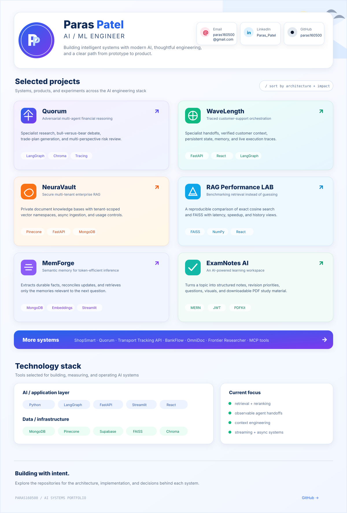

 

 

## Repository links

The portfolio board above is a visual overview. These links provide direct access to the implementation behind each project.

### Featured systems

- [Quorum — Adversarial Multi-Agent Deliberation for Financial Reasoning](https://github.com/paras160500/Quorum-Adversarial-Multi-Agent-Deliberation-for-Financial-Reasoning)
- [WaveLength — Multi-Agent Orchestration with Tracing](https://github.com/paras160500/WaveLength-Multi-Agent-Orchestration-with-Tracing)
- [NeuraVault — Multi-Tenant Enterprise RAG](https://github.com/paras160500/NeuraVault-Multi-Tenant-Enterprise-RAG-Platform-with-Secure-AI-Knowledge-Isolation)
- [RAG Performance LAB](https://github.com/paras160500/RAG-Performance-LAB-FastAPI-React-Tailwind)
- [MemForge — Semantic Memory Orchestration](https://github.com/paras160500/MemForge-Semantic-Memory-Orchestration-for-Token-Efficient-LLM-Inference)
- [ExamNotes AI — MERN AI Exam Helper](https://github.com/paras160500/MERN-AI-Exam-Helper)

### Additional systems

- [ShopSmart — HyDE RAG E-commerce Platform](https://github.com/paras160500/HyDE-RAG-Ecommerce-Platfrom-with-Comparision-to-Standard-RAG)
- [BankFlow Backend](https://github.com/paras160500/BankFlow-Backend)
- [Transport Tracking Backend API](https://github.com/paras160500/Transport-Tracking-Backend-App-NodeJS)
- [OmniDoc RAG](https://github.com/paras160500/OmniDoc-RAG-Advanced-Multimodal-Retrieval-Augmented-Generation)
- [Frontier AI Product Researcher](https://github.com/paras160500/Frontier-AI-Product-Researcher-MAS-RAG)
- [Live Recruiter Agent](https://github.com/paras160500/Live-Recruiter-Agent---Oracle-Cloud-MAS-RAG)
- [MCP Web Scrapper](https://github.com/paras160500/MCP-Web-Scrapper-for-code-suggestions)
- [DeepSeek Reasoning RAG](https://github.com/paras160500/DeepSeek_Reasoning_RAG)
- [SQL Library Management](https://github.com/paras160500/SQL_Library_Management_Advance_Project)
- [mindspace_AgenticAI](https://github.com/paras160500/mindspace_AgenticAI)

 

<a href="https://github.com/paras160500"><b>View all repositories →</b></a>

<!-- Keep assets/portfolio-board.svg beside this README. -->
